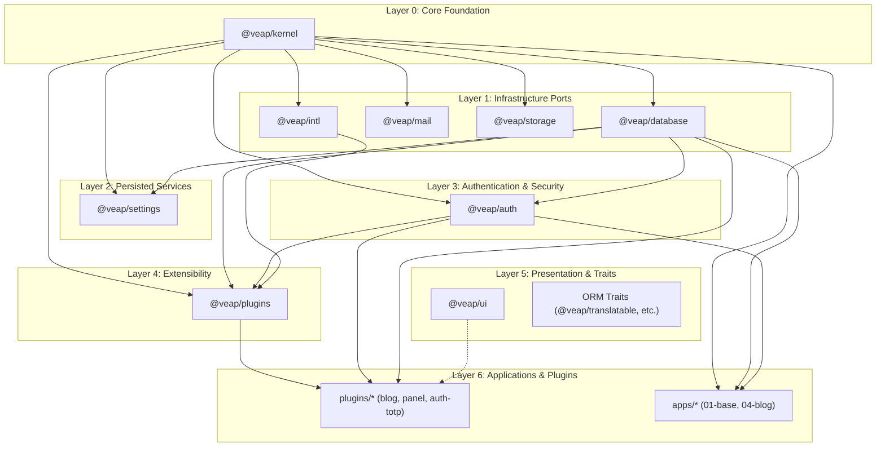

# Veap ecosystem architecture

This document describes the architectural foundation of the Veap framework, the
monorepo structure, dependency invariants, IoC design patterns, and how packages
integrate with the Next.js runtime.

---

## 1. Monorepo organization

The Veap ecosystem is organized as a Bun monorepo comprising framework packages,
official plugins, scaffolding templates, and documentation.

```
veap-repo/
├── apps/                    # Applications and documentation site
│   ├── 01-base/             # Reference implementation with Next.js App Router
│   ├── 03-rest-api/         # REST API reference application
│   ├── 04-blog/             # Blog example showcasing ORM traits and plugins
│   ├── 05_fullstack/        # Full-stack example with authentication and i18n
│   └── veap-docs/           # Next.js documentation site (veap.pl)
├── packages/                # Core framework packages (published to npm)
│   ├── kernel/              # Lifecycle, IoC container, events, cache, config, HTTP
│   ├── database/            # Active Record ORM, Knex query builder, migrations
│   ├── auth/                # Users, hashed sessions, RBAC, Server Actions
│   ├── mail/                # Mailer port, SMTP/console transports, localized messages
│   ├── storage/             # File storage port, local disk provider
│   ├── intl/                # ICU translation service, locale negotiation
│   ├── settings/            # Database-persisted key/value settings with cache
│   ├── plugins/             # Plugin manager, virtual router, extension points
│   ├── ui/                  # Shared React UI components and Tailwind theme
│   ├── create-veap/         # Application scaffolder CLI (`bun create veap`)
│   └── veap-*/              # Specialized ORM traits (categorizable, commentable, etc.)
├── plugins/                 # Official modular plugins (for example, blog, auth-totp, panel)
├── templates/               # Starters used by `create-veap`
└── docs/                    # Documentation sources
    ├── developer-docs/      # Application developer documentation
    └── maintainer-notes/    # Maintainer guidelines and technical architecture
```

### Git submodules and Bun workspaces

The core packages under `packages/*` and `plugins/*` originated as independent
repositories under the `veapjs` GitHub organization. In this monorepo:

- They are configured as **Git submodules** via `.gitmodules`.
- They are simultaneously registered as **Bun workspaces** in root `package.json`:
  ```json
  "workspaces": [
    "apps/*",
    "packages/*",
    "plugins/*",
    "templates/*"
  ]
  ```
- Bun creates symlinks in `node_modules` resolving local workspace dependencies
  instantly without requiring local package builds or npm registry round-trips.

---

## 2. Layered architecture and dependency invariants

Veap enforces a strict unidirectional dependency graph. Lower-level packages
must never import from higher-level packages.



### Dependency invariants table

The following table defines the permitted internal dependencies and architectural responsibilities for each package in the monorepo:

| Package | Allowed Internal Dependencies | Architectural Role |
|---|---|---|
| `@veap/kernel` | *None* | Foundation: IoC, event bus, config, logger, cache port, HTTP contracts, CLI engine. |
| `@veap/database` | `@veap/kernel` | ORM: Active Record Model, Knex connection pool, migrations, transactions. |
| `@veap/mail` | `@veap/kernel` | Communication: Mailer port, message formatter, SMTP/console transports. |
| `@veap/storage` | `@veap/kernel` | File persistence: Storage port, disk adapter, stream handling. |
| `@veap/intl` | `@veap/kernel` | Localization: Message catalogs, ICU formatting, locale negotiation. |
| `@veap/settings` | `@veap/kernel`, `@veap/database` | Key/value store: Database-backed configuration cache. |
| `@veap/auth` | `@veap/kernel`, `@veap/database` | Identity: Users, sessions, password hashing, RBAC, Server Action wrappers (notifications decoupled via `IAuthNotificationService`). |
| `@veap/plugins` | `@veap/kernel`, `@veap/database`, `@veap/auth`, `@veap/intl` (optional peer: `@veap/ui`) | Extensibility: Plugin lifecycle, extension point slots, virtual router. |
| `@veap/ui` | *None (framework-agnostic React)* | Design system: Tailwind components, buttons, form controls, dialogs. |

---

## 3. Core runtime concepts

The runtime architecture centers on dependency injection, lifecycle hooks, and decoupled service ports.

### Inversion of Control (IoC) and service providers

Veap applications and packages coordinate through an Inversion of Control (IoC)
container provided by `@veap/kernel`.

- **`Container`**: A dependency injection container that supports
  transient instances, singletons, value bindings, and factory resolutions.
- **`ServiceProvider`**: The unit of packaging in Veap. Every package provides
  one or more service providers implementing lifecycle hooks:
  - `register()`: Binds tokens, interfaces, and singletons into
    the container. No side effects or database access should occur here.
  - `boot()`: Asynchronously initializes services, connects to databases, runs
    bootstrap checks, or subscribes to events.

```ts
import { ServiceProvider } from "@veap/kernel";

export class DatabaseServiceProvider extends ServiceProvider {
  override register(): void {
    // 1. Bind tokens and singletons
    this.container.register({
      token: DATABASE_SERVICE,
      useFactory: () => new DatabaseService(this.container),
      singleton: true,
    });
  }

  override async boot(): Promise<void> {
    // 2. Perform asynchronous startup tasks
    const db = await this.container.resolve(DATABASE_SERVICE);
    await db.verifyConnection();
  }
}
```

### Ports and adapters (hexagonal architecture)

Veap packages decouple domain logic from concrete infrastructure using typed
ports:

1. **Port (interface):** Declared in `@veap/kernel` or the service package (for example,
   `IMailer`, `IStorageProvider`, `ICacheProvider`, `ILogger`).
2. **Adapter (implementation):** Provided by the service package or application
   (for example, `NodemailerMailService`, `LocalFileProvider`, `MemoryCacheProvider`).
3. **Binding token:** A unique symbol, class, or string used to register and resolve the
   adapter through the container (for example, `MAILER`, `STORAGE_SERVICE`, `LOGGER`).

This pattern enables seamless swapping of infrastructure during testing (such as
in-memory mailers or mock storage) without altering business logic.

---

## 4. Composition root and module augmentation

Veap applications configure and boot their active service providers through a centralized composition root.

### The composition root (`lib/veap.ts`)

Applications assemble their active packages in a single composition root:

```ts
// lib/veap.ts
import { Application } from "@veap/kernel";
import { DatabaseServiceProvider } from "@veap/database";
import { AuthServiceProvider } from "@veap/auth";

export const app = Application.configure()
  .use(DatabaseServiceProvider)
  .use(AuthServiceProvider)
  .create();

export async function initializeSystem() {
  await app.bootstrap();
  return app;
}
```

### Module augmentation via `composition.ts`

To provide an ergonomic fluent API on `ApplicationBuilder` (for example,
`.withMigrations()`, `.withMail()`, `.withPlugins()`, `.withSettings()`), packages use TypeScript
**module augmentation**:

```ts
// packages/mail/src/composition.ts
import { ApplicationBuilder } from "@veap/kernel";
import { MailServiceProvider } from "./provider.js";

declare module "@veap/kernel" {
  interface ApplicationBuilder {
    withMail(): this;
  }
}

ApplicationBuilder.prototype.withMail = function (
  this: ApplicationBuilder,
): ApplicationBuilder {
  return this.use(MailServiceProvider);
};
```

When an application imports `@veap/mail`, TypeScript automatically broadens
`ApplicationBuilder` to include `.withMail()`.

---

## 5. Next.js runtime boundary

Veap is engineered to augment Next.js, not replace it:

- **Next.js retains authority over:**
  - Route handlers (`app/api/**/route.ts`)
  - React Server Components (RSC) and client component rendering
  - Build-time bundling, code splitting, and Turbopack
  - Edge and Node.js deployment adapters (Vercel, Docker, standalone)
- **Veap provides:**
  - Domain application lifecycle and IoC container
  - Active Record ORM and migrations
  - Session authentication, RBAC, and Server Action Result validation
  - Pluggable extension points and modular routing

### Preventing build-time side effects

Because Next.js executes server code during static generation, application
composition roots must avoid running database migrations or initiating socket
connections during top-level module evaluation.

`initializeSystem()` is therefore cached and executed explicitly inside runtime
entry points (such as `app/layout.tsx` or Server Actions), guarded by runtime
checks (`process.env.NEXT_PHASE !== "phase-production-build"`).
