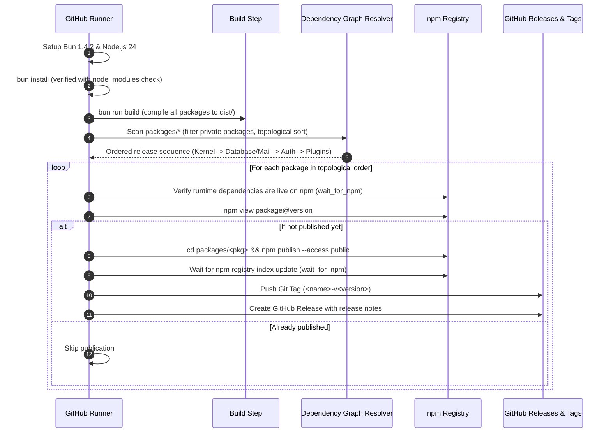

# Release, versioning, and CI/CD pipeline

This guide details the versioning lifecycle, dependency alignment rules, and the
automated GitHub Actions release workflow used to publish packages across the
Veap monorepo.

---

## 1. Versioning with Changesets

The monorepo uses [Changesets](https://github.com/changesets/changesets) to track
intent, write changelogs, and bump semver versions.

### Creating a changeset

When you open a pull request or commit a feature, fix, or breaking change to any
package under `packages/`:

1. Run the changeset command:
   ```bash
   bun run changeset
   ```
2. Select which packages are modified using the interactive prompt.
3. Choose the bump type (`patch`, `minor`, or `major`).
4. Write a concise, descriptive explanation of the change.
5. Commit the generated file under `.changeset/<random-name>.md`.

### Applying version bumps

When preparing a release:

1. Run:
   ```bash
   bun run version-packages
   ```
   This command consumes the markdown files in `.changeset/`, updates the
   `version` field in relevant `package.json` files, updates internal dependency
   version constraints, and updates `CHANGELOG.md` files.
2. Commit the updated manifests and changelogs before pushing to `main`.

---

## 2. Dependency alignment rules

Because Veap is a monorepo containing multiple interconnected packages, strict
dependency alignment is required to ensure clean package resolution both locally
and on the npm registry.

### Rule 1: never use `workspace:*` in published packages

Packages under `packages/` that are published to the npm registry must specify
exact semver versions or ranges matching the workspace version (for example, `"0.1.7"` or
`"^0.1.7"`).

The release workflow explicitly scans package manifests and throws an error if any
runtime dependency uses `workspace:*`:

```js
if (name.startsWith("@veap/") && range.startsWith("workspace:")) {
  throw new Error(`${pkg.name}: ${name} still uses ${range}`);
}
```

<!-- prettier-ignore -->
> [!NOTE]
> `workspace:*` is permitted in applications (`apps/*`) and template projects
> that are not published as standalone npm libraries.

### Rule 2: keep internal `@veap/*` dependencies aligned

All packages and plugins in the monorepo must reference identical versions of
internal `@veap/*` packages. For example, if `@veap/database` is version `0.1.7`,
every package depending on `@veap/database` must specify `"0.1.7"` or `"^0.1.7"`.

**What happens if versions diverge?**
If a workspace package requests an older version (for example, `"0.1.2"`), Bun cannot
resolve it to the local workspace (`"0.1.7"`). It attempts to download the older
version from npm while simultaneously linking the local workspace package for
other dependencies. This creates conflicting resolution trees and corrupts
`bun.lock` with duplicate paths:

```
error: Duplicate package path at bun.lock:1628:5
InvalidLockfile: failed to parse lockfile: 'bun.lock'
```

---

## 3. The release pipeline (`.github/workflows/release.yml`)

Releases are automated via GitHub Actions on every push to the `main` branch or
via manual `workflow_dispatch`.

### Pipeline execution stages



### Key safety mechanisms in the workflow

1. **Topological graph sorting:** Packages are published strictly in order of
   their dependency graph. Independent packages (`@veap/kernel`) publish first,
   followed by direct consumers (`@veap/database`, `@veap/mail`), followed by
   higher-level services (`@veap/auth`, `@veap/plugins`).
2. **Exclusion of private packages:** The workflow checks `if (pkg.private) continue;`.
   Private packages (such as unpublished traits or internal tooling) are safely
   skipped and never passed to `npm publish`.
3. **Sequential registry polling (`wait_for_npm`):** When package B depends on
   package A, the workflow publishes package A and then actively polls the npm
   registry until `npm view @veap/A@version` confirms it is live before attempting
   to publish package B. This prevents race conditions where npm fails because an
   upstream dependency was published seconds earlier and has not propagated
   globally.
4. **Collision-free tagging:** Tags are prefixed with the package name without the
   scope: `${SAFE_NAME}-v${PKG_VERSION}` (for example `kernel-v0.2.0`,
   `database-v0.1.7`, or `create-veap-v0.4.5` for unscoped packages). This
   prevents Git tag collisions when multiple packages share the same version
   number.

---

## 4. Troubleshooting common release failures

Use the following solutions to diagnose and recover from common release pipeline errors:

### Issue: `error: Duplicate package path at bun.lock`
- **Cause:** A package in `packages/` or `plugins/` has a pinned version of an
  internal `@veap/*` dependency that does not match the version defined in that
  package's local manifest.
- **Solution:**
  1. Search for mismatched versions across the monorepo:
     ```bash
     grep -rn '"@veap/database"' packages/ plugins/
     ```
  2. Update all occurrences to match the current monorepo version.
  3. Run `bun install` to regenerate a clean `bun.lock`.
  4. Verify with `bun pm ls`.

### Issue: `npm error code EPRIVATE`
- **Cause:** A package has `"private": true` in `package.json`, but the release
  workflow attempted to execute `npm publish`.
- **Solution:**
  Ensure the release workflow skips private packages (`if (pkg.private) continue;`)
  or remove `"private": true` if the package is ready for public release.

### Issue: `Timeout waiting for package@version on npm`
- **Cause:** Network latency or npm registry indexing delay exceeded `NPM_TIMEOUT`
  (default 1200 seconds / 20 minutes).
- **Solution:**
  Re-run the workflow from GitHub Actions. Because the pipeline is idempotent, it
  detects already-published packages and resumes exactly where it left off.
